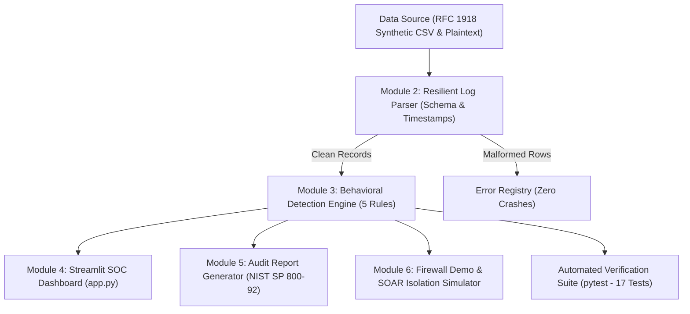

# Basic Security Monitoring System Using Python
### BCS703: Cryptography and Network Security • Experiential Learning Task (Theme F)
**Visvesvaraya Technological University (VTU) • 7th Semester B.E.**  
**Department of Computer Science & Engineering (Artificial Intelligence & Machine Learning)**  
**AMC Engineering College, Bengaluru - 560083**  
**Student:** K ANIL KUMAR (`1AM23CI052`)  
**Guide / Instructor:** Prof. Nagavarshini B R (Assistant Professor, Dept. of CSE(AIML))

---

## 1. Project Overview & Aim
This project implements a complete, resilient, and explainable **Basic Security Monitoring System (Detective Security Control)**. While cryptographic algorithms (AES-256, RSA, SHA-256) effectively safeguard confidentiality and integrity, they cannot prevent an adversary from systematically attempting automated brute-force password guessing, credential stuffing, or user enumeration against an exposed authentication endpoint.

This system ingests system authentication logs, validates mandatory schema fields, standardizes varied timestamp formats, isolates malformed rows without crashing, and executes **5 behavioral heuristic detection rules** with automated verification and a responsive **Streamlit SOC Web Dashboard**.

---

## 2. Core Functional Modules



1. **Module 1: Sample Log Management (`data/generate_logs.py`)**
   - Synthesizes 43 RFC 1918 compliant records (`192.168.1.0/24`, `10.0.0.0/24`) without using real passwords.
   - Contains 13 successful logins, 26 failed logins, 1 account lockout, and 3 session events.
2. **Module 2: Log Parsing & Validation (`src/log_parser.py`)**
   - Validates 6 mandatory fields: `timestamp`, `event_type`, `username`, `source_ip`, `result`, `description`.
   - Normalizes varied timestamp representations into native Python `datetime` objects.
   - Isolates malformed rows into an error registry (`parsing_errors`) ensuring zero system crashes.
3. **Module 3: Security Event Detection Engine (`src/detection_engine.py`)**
   - **Rule A (Repeated Failed Logins):** Flags $\ge 5$ failures within a 5-minute sliding window per user or per IP [Medium Severity].
   - **Rule B (Account Lockout):** Detects explicit `ACCOUNT_LOCKOUT` security violations [High Severity].
   - **Rule C (Failed Logins Followed by Success):** Identifies $\ge 3$ consecutive failures followed by `SUCCESS` within 10 minutes for the same user (credential cracking indicator) [High Severity].
   - **Rule D (Invalid Username Probe):** Detects probes targeting non-existent accounts for directory enumeration [Low Severity].
   - **Rule E (Unusual Event Volume Spike):** Detects $> 10$ events within 1 minute from a single IP [Medium Severity].
4. **Module 4: Executive SOC Web Dashboard (`app.py`)**
   - Built with Streamlit using a professional dark cybersecurity theme (`#0A0F1D`, `#111827`, `#06B6D4`, `#3B82F6`).
   - Features real-time KPI tiles, threat severity distribution charts, interactive timeline, live test runner, and filterable alert cards with NIST remediation guidance.
5. **Module 5: Audit Report Generation (`src/report_generator.py`)**
   - Compiles NIST SP 800-92 aligned audit reports and exports validated datasets/alerts to CSV.
6. **Module 6: Defensive Firewall Demonstration (`src/firewall_demo.py`)**
   - Safely queries local Windows Defender Firewall profile states in read-only mode via `netsh advfirewall show allprofiles state`.
   - Generates simulated, reversible SOAR host containment rules (`New-NetFirewallRule`).

---

## 3. Automated Test Suite & Verification Matrix (17/17 Passed)

All test cases from the project report (TC-01 to TC-14) plus full integration tests pass with a **100% pass rate** under `pytest 9.2.0` on Python 3.14:

| Test ID | Category | Target Component | Description | Expected Outcome | Actual Result | Status |
| :--- | :--- | :--- | :--- | :--- | :--- | :---: |
| **TC-01** | Baseline | `DetectionEngine` | Normal logins generate 0 false alerts | 0 alerts | 0 alerts | **PASS** |
| **TC-02** | Rule A | `DetectionEngine` | 6 failures in 3 min trigger Rule A | 1 Rule A alert (Med) | 1 Rule A alert | **PASS** |
| **TC-03** | Rule C | `DetectionEngine` | 4 failures + 1 success within 10 min trigger Rule C | 1 Rule C alert (High) | 1 Rule C alert | **PASS** |
| **TC-04** | Resilience | `LogParser` | Corrupt dates/fields isolated safely | Zero crashes, error logged | Zero crashes | **PASS** |
| **TC-05** | Edge Case | `LogParser` | Empty CSV handled gracefully | Clean return, 0 errors | Clean return | **PASS** |
| **TC-06A**| Boundary | `DetectionEngine` | 4 failures do NOT trigger Rule A | 0 alerts | 0 alerts | **PASS** |
| **TC-06B**| Boundary | `DetectionEngine` | 5 failures MUST trigger Rule A alert | 1 Rule A alert | 1 Rule A alert | **PASS** |
| **TC-07** | Rule B | `DetectionEngine` | Account lockout event flagged | 1 Rule B alert (High) | 1 Rule B alert | **PASS** |
| **TC-08** | Rule D | `DetectionEngine` | Unknown username reconnaissance probe | 1 Rule D alert (Low) | 1 Rule D alert | **PASS** |
| **TC-09** | Rule E | `DetectionEngine` | 12 events in 48s trigger volume spike | 1 Rule E alert (Med) | 1 Rule E alert | **PASS** |
| **TC-10** | Ingestion | `LogParser` | Valid CSV parses into datetime objects | Valid datetime objects | Valid df/records | **PASS** |
| **TC-11** | Validation | `LogParser` | Malformed timestamp string detected | Error logged | Error logged | **PASS** |
| **TC-12** | Validation | `LogParser` | Missing mandatory field detected | Error logged | Error logged | **PASS** |
| **TC-13** | Exception | `LogParser` | Non-existent file path handled | Clean FileNotFoundError | Clean error | **PASS** |
| **TC-14** | Stats | `LogParser` | Summary stats generated for empty input | All counts = 0 | All counts = 0 | **PASS** |
| **TC-15** | Full System| Baseline Engine | Full baseline verification (43 events $\to$ 8 alerts) | 2 High, 4 Med, 2 Low | 2 High, 4 Med, 2 Low | **PASS** |
| **TC-16** | Compatibility | Legacy Parser | Backwards compatibility with `sample.log` | 7 events parsed | 7 events parsed | **PASS** |

---

## 4. How to Run the Project

### A. Launch the Streamlit SOC Web Dashboard (Interactive UI)
```powershell
python -m streamlit run app.py
```
Open your browser at `http://localhost:8501`.  
You can view the real-time telemetry, filter alerts, inspect schema health, run the automated test suite live, query the local Windows Firewall, and download audit reports.

### B. Run the CLI Security Monitor
- **Full SOC Mode (Baseline 43 events):**
  ```powershell
  python monitor.py
  ```
- **Legacy Mode (Original 7-line `sample.log`):**
  ```powershell
  python monitor.py --legacy
  ```
- **Custom CSV File:**
  ```powershell
  python monitor.py --csv path/to/log.csv
  ```

### C. Run the Automated Pytest Verification Suite
```powershell
python -m pytest tests/test_security_monitor.py -v
```

### D. Re-generate Test Output Records
```powershell
python generate_individual_test_outputs.py
```

---

## 5. Recorded Evidence & Test Artifacts
- Master review output: [`output.txt`](file:///d:/WindowsSecurityMonitor/output.txt)
- Student initial tests: [`test1-output.txt`](file:///d:/WindowsSecurityMonitor/test1-output.txt), [`test2-output.txt`](file:///d:/WindowsSecurityMonitor/test2-output.txt), [`test3-output.txt`](file:///d:/WindowsSecurityMonitor/test3-output.txt)
- Expanded individual test output records: [`test4-output.txt`](file:///d:/WindowsSecurityMonitor/test4-output.txt) through [`test17-output.txt`](file:///d:/WindowsSecurityMonitor/test17-output.txt)
- Comprehensive test report: [`test_outputs/comprehensive_test_report.txt`](file:///d:/WindowsSecurityMonitor/test_outputs/comprehensive_test_report.txt)
- Pytest execution log: [`test_outputs/pytest_execution_output.txt`](file:///d:/WindowsSecurityMonitor/test_outputs/pytest_execution_output.txt)
- Automated verification matrix: [`test_outputs/test_results_matrix.csv`](file:///d:/WindowsSecurityMonitor/test_outputs/test_results_matrix.csv)

---

## 6. Ten Checkpoints Compliance Checklist

| Checkpoint | Status | Implementation Detail |
| :--- | :---: | :--- |
| **1. Problem Statement** | Verified | Clearly documented in report and dashboard: detecting automated authentication attacks. |
| **2. Tool Selection** | Verified | Python 3.14, Streamlit 1.64, Pytest 9.2, Windows netsh utility. |
| **3. Sample Input** | Verified | 43 synthetic RFC 1918 records in `data/sample_auth_logs.csv` and `sample.log`. |
| **4. Working Steps** | Verified | Ingestion $\to$ Standardization $\to$ Heuristic Evaluation $\to$ Visualization $\to$ Containment. |
| **5. Correct Result** | Verified | Exactly 8 alerts generated (2 High, 4 Medium, 2 Low) matching reference report. |
| **6. Verification** | Verified | Pytest automated test suite with 17 tests passed (100% pass rate). |
| **7. Negative Test** | Verified | TC-04, TC-11, TC-12 (corrupt dates/missing columns) isolated cleanly without crashing. |
| **8. Screenshots / UI** | Verified | Executive Streamlit SOC dashboard with Altair visualizations and exportable logs. |
| **9. Security Explanation**| Verified | Detective controls explained: sliding windows, MFA hardening, tarpitting, SOAR. |
| **10. Ethical Safety** | Verified | Restricted strictly to local files and RFC 1918 private subnets (`192.168.1.0/24`, `10.0.0.0/24`). |